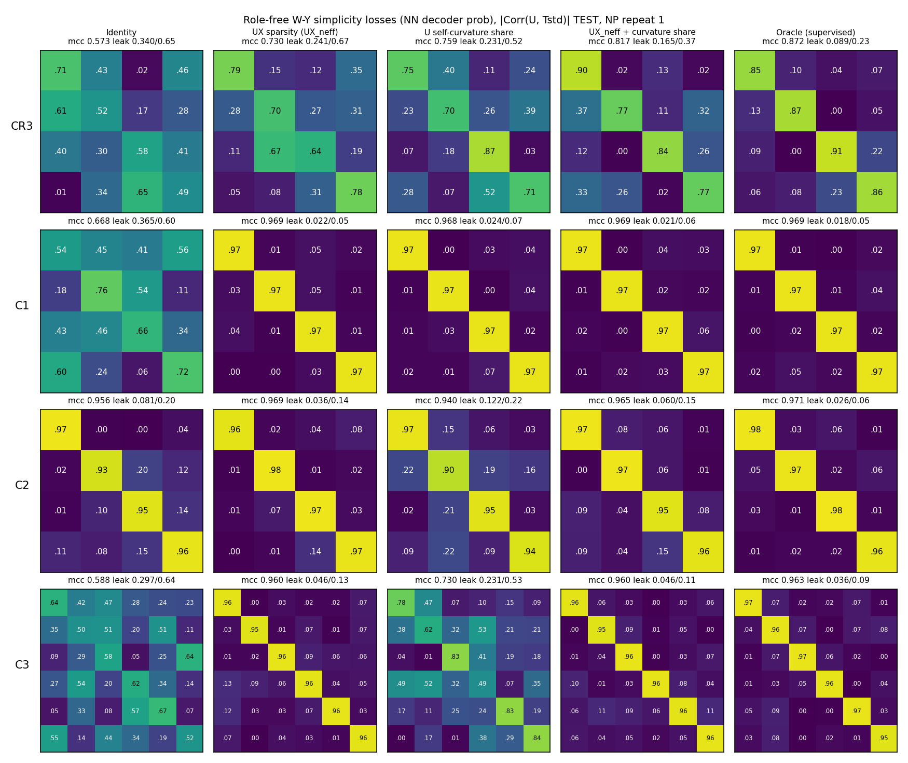
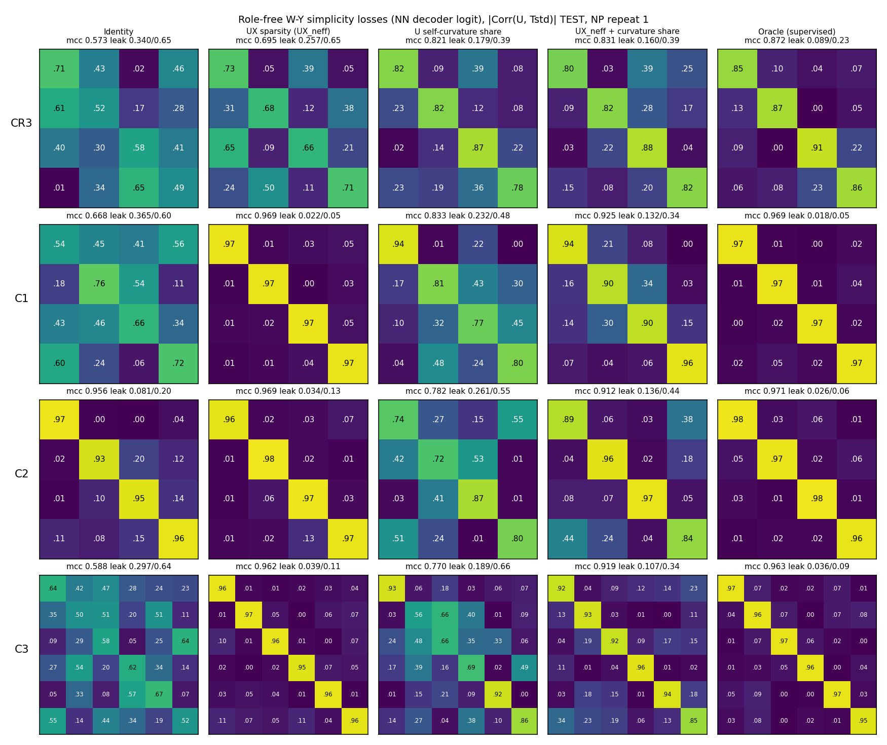

# 09 · ModLearn latent rotation: 项目总览、历史方法复现与全部主要结果

> 更新：2026-11-15  
> 本文是跨仓库的研究总览及复现手册：原始连续 Sim1 → M1–M4 功能旋转 → DDM choice+RT Fisher → categorical V1/V2 → Mod-Rot-3 EXP13 → 最新后续实验。  
> 阅读对象：研究合作者、后续实验执行者及 Codex。本文只新增文档，不改变任何历史方法或结果。  
> 证据区分：**GitHub 实测**表示仓库有数值报告/文件；**历史记录**表示此前会话中对本地输出的记录，原始文件尚未重新取得；**机制分析**表示公式推导而非新实验。不要混淆三者。所有仓库链接需要相应访问权限。

## 0. 项目导航与版本边界

| 阶段 | 仓库 / 代码 | 主要结果来源 |
|---|---|---|
| 原始 Sim1 continuous | [moderational-learning-dm 原始模拟](https://github.com/bs-zhao/moderational-learning-dm/tree/31864e32386a93b73e224810441803c2ada2f7f1/simulation_studies/sim1_linear) | 原本地 XZ-Geomin 输出，见 §2；[历史方法移植](../../rotations/historical_transfer/RESULTS.md) |
| 后续 rot1 M1–M4 | [modlearn-rot](https://github.com/Cognition-Decision-Modeling-Lab/modlearn-rot/tree/main) | 本地 outputs；[算法](https://github.com/Cognition-Decision-Modeling-Lab/modlearn-rot/blob/main/src/modlearn_rot/rotation.py) |
| DDM Sim1 choice+RT | [latent_choice_rt-v1 原始代码](https://github.com/Cognition-Decision-Modeling-Lab/latent_choice_rt-v1/tree/2f5b1e921084c687ef01b3c0486b81920c429507/experiment/sim1_ddm) | 原本地 evaluation NPZ；[移植报告](../../rotations/historical_transfer/RESULTS.md) |
| Choice V1/V2 | [modlearn-rot-2 旋转](https://github.com/Cognition-Decision-Modeling-Lab/modlearn-rot-2/tree/main/experiment/rotation/choice/decoder_fisher_jointdiag) | 本地 r3/r4 输出及历史记录，见 §4 |
| EXP13 | [原始方法](../../three_gaps/exp13_pure_simplicity/README.md) | [原始 CSV](../../three_gaps/exp13_pure_simplicity/results/heatmaps_simplicity_rep1.csv)、[冻结基线](../../three_gaps/post_exp13_20261114/baseline/README.md) |
| 其他近期实验 | [three_gaps](../../three_gaps/README.md) | [完整日志](../../three_gaps/EXPERIMENT_LOG.md)、[EXP14–19](../../three_gaps/post_exp13_20261114/RESULTS.md)、[2026-11-15 独立复现](../../three_gaps/gpt_wave07_20261115/RESULTS.md)、[稀疏性目录 EXP24](../../three_gaps/exp24_sparsity_catalog/README.md) |

注意：modlearn-rot 当前只整合 continuous M1–M4 pipeline，并没有独立命名为 v1/v2 的 choice 方法；后者位于 modlearn-rot-2。Sim1 原始六参数线性模型与后来 M1–M4 不是同一数据。DDM 的原始 observed-X Fisher-Geomin 与 categorical V1 的 subject-mean functional operator JD 也不是同一 loss。本文中 EXP24 指已经实施的 sparsity_catalog；[README 08](08_derivative_aware_decoder_engineering.md) 的 EXP24–31 是另一套 decoder engineering 计划编号，实际执行时用独立目录或重新编号，不能覆盖已存在的 EXP24。

## 1. 科学问题：从行为预测到参数坐标发现

### 1.1 数据生成、NP 与旋转不确定性

每位被试 s 有真实参数 T_s，同一人的各试次共享 T_s。刺激 X_st 与 T_s 决定行为分布：

$$
Y_{st}\sim p^*(Y\mid T_s,X_{st}),\qquad Z_s=E_\phi(\{(X_{st},Y_{st})\}_t).
$$

连续模型预测均值，二元选择输出 logits/概率，DDM 学习 choice 与条件 RT 的联合分布。NP/βVAE 使用 MSE、CE 或 CE+flow NLL 与 KL（可加 latent L1），只看行为，不见真实 T。训练后固定 encoder 和 decoder，使用每人全部已观察试次提取 posterior mean Z。预测好并不意味着每个 Z 维度天然对应一个认知参数；许多不同坐标描述同一预测函数。

若 U=R(Z-mu)，列向量约定，R 正交，则
$$
f_R(U,X)=f_\psi(\mu+R^\top U,X)=f_\psi(Z,X).
$$
行存储为 U=(Z-mu)R^T。若一般可逆 A，则逆映射为 A^{-1}，不能误用转置。若仅旋转 active subspace，必须保留未选维度/残差以保证完整 decoder 预测等价。

**研究目标不是重新拟合预测 loss，而是搜索 R，使等价函数在 U 坐标下具有简单的功能结构，并希望 U 与 T 一一对应（允许符号、排列、尺度差异）。**
$$
R^*=\arg\min_{R\in SO(d)}\mathcal L_{simple}(f_R,P_{Z,X}).
$$
一般线性变换是更宽松的另一个研究问题，历史 JVolmax 属于此类。PCA/白化与原始 Z 正交旋转也是不同可行族，不把它们的结果直接当作同一优化的胜负。

### 1.2 Simple structure 与三鸿沟

已有方法用下列结构构造 loss：latent 梯度 g_U；梯度随 X 变化（H_UX）；刺激高阶形状（T_UXX）；真正的参数二阶作用（H_UU）；预测分布 Fisher。Geomin、entropy、joint diagonalization、neff、self-curvature share 都是不同简单性定义，而不是预测误差。

最终盲方法不得使用 T、真实公式、参数角色、监督 Oracle 选轴或选超参数。模拟真值只用于独立事后评价，或明确标注的 Oracle/解析诊断。三鸿沟定义见 [three_gaps README](../../three_gaps/README.md)：Gap1 解析式上的目标是否偏好真实轴；Gap2 只给解析式生成的 W=[Z,X]、Y 时是否能估计相同目标；Gap3 将 Y 换成 NN 生成值后是否仍然成立。decoder autograd/query 是中间证据，不等于严格 WY-only。还需区分实际 choice、NN 概率、NN logit。

### 1.3 统一评价口径

历史 Sim1、DDM、V1/V2 使用单轴交叉验证 R²：对每个 U_i,T_j 拟合一元线性回归，交叉验证，再一一匹配；同时保存多变量 R² 与 Pearson r。EXP13 使用 TEST MCC=Hungarian 最大绝对相关的均值；leakage=非匹配绝对相关均值，另报最大非匹配及最差匹配。historical_transfer 使用 TRAIN Pearson 一一匹配再算 TEST r²。它们不是同一个统计量；mean r² 也不是 MCC²。每个数字必须附模型、坐标、split、checkpoint 与评价定义。Oracle 是监督数值参考，不是无监督成绩，也不一定是严格全局上界。

## 2. 连续 Sim1：从梯度功能签名到共享 X 曲率细化

### 2.1 原始 sim1_linear（六参数）

原始训练代码：[s1_gen_train_batch.py](https://github.com/bs-zhao/moderational-learning-dm/blob/31864e32386a93b73e224810441803c2ada2f7f1/simulation_studies/sim1_linear/s1_gen_train_batch.py)。原始 Flex6Lv2b:
$$
Y=\sum_{j=1}^6 b_j X_j+\epsilon,\quad X_j\sim U(-2,2),\ b_j\sim N(4,1).
$$
inactive 参数固定 1；六自由参数时全部随机。目标生成 R²=.8，Var(signal|b)=4/3 sum b²，noise SD=sqrt(Var(signal)/4)。历史 checkpoint 文件名显示 nsubj=2000、100–200 trials、latent16、embedding32、beta1、context 50–150、repeat1；[六参数 checkpoint](https://github.com/bs-zhao/moderational-learning-dm/blob/31864e32386a93b73e224810441803c2ada2f7f1/simulation_studies/sim1_linear/save/train_batch/Flex6Lv2b_latent_16_emb_32_l1_0_l2_0_beta_1_nsubj_2000_min_100_max_200_input_6_minpick_50_maxpick_150_repeat_1.pkl)。注意现有训练脚本默认 data_name 已切到另一模型，复现须设置 Flex6Lv2b/input_dim6；建议在隔离副本重现，不覆盖历史。

先前 point-mean Fisher-Geomin 仅用梯度外积，效果不理想。成功的 XZ-Geomin 版本的核心是对每个观测点计算 g_q=∂mean/∂q，然后把试次内变化转成 X 方向功能签名。选出有信息的 K 维 Z 并标准化（历史原坐标选择与后来的 PCA 白化要区分），冻结原完整 decoder，沿选定坐标求导，未选维度保持被试原值。原本地脚本 simulation_studies_v2/sim1_linear/fisher/s2_observed_x_xz_rotation.py；该文件不在上述 GitHub 原始提交内。可核实的后续移植保留了算法函数：[regression_reference.py](../../rotations/historical_transfer/regression_reference.py)、[methods.py](../../rotations/historical_transfer/methods.py)。

对每人中心化 X 和 G，再按 X 的总体 SD 标准化，做多输出 OLS：
$$
G_{st}^c=G_{st}-\bar G_s,\quad X_{st}^c=X_{st}-\bar X_s,\quad
\hat B=\arg\min_B||G^c-X^{c,std}B||_F^2 .
$$
B 的行是刺激功能，列是 latent 轴。旋转 B_R=BR^T，Geomin
$$
L(R)=\sum_j w_j\exp\left[\frac1d\sum_i\log((B_R)_{ji}^2+\epsilon)\right].
$$
实际行/块标准化、epsilon 和搜索见 [移植方法](../../rotations/historical_transfer/methods.py)；其来源是后来 rot1 archive，不能声称与原始本地脚本逐字相同。通过 skew matrix exponential 搜索正交 R。线性均值下 G 随 X 线性，B 等价于带 X 尺度的 UX 导数；对复杂模型则只是全局线性投影。

**历史记录（原始输出未重新取得）**：约 5000 观测行，Geomin .114→.023，gradient 回归解释率约 .86–.89；单轴 CV R² 从 (.36,.27,.19,.56,.56,.43) 到 (.823,.799,.828,.822,.800,.833)，对应 r=(.908,.894,-.911,.908,-.896,.914)。原始 Fisher-only Geomin .09514→.09115 但轴恢复失败；监督方向可达约 .897–.915 的 |r|。因此目标降低本身并不证明恢复。历史路径 fisher/output_xz/ 与 fisher/output/observed_x_fisher_rotation_results.npz，未有可核实的公开 GitHub 结果链接。以上数值是此前对本地结果的会话记录，不是本次新运行。

### 2.2 后续 M1–M4（当前 modlearn-rot）

[生成器](https://github.com/Cognition-Decision-Modeling-Lab/modlearn-rot/blob/main/experiment/sim1_rotation/rot1_data.py) · [训练入口](https://github.com/Cognition-Decision-Modeling-Lab/modlearn-rot/blob/main/experiment/sim1_rotation/s1_gen_train.py) · [旋转入口](https://github.com/Cognition-Decision-Modeling-Lab/modlearn-rot/blob/main/experiment/sim1_rotation/run_rotation.py) · [完整算法](https://github.com/Cognition-Decision-Modeling-Lab/modlearn-rot/blob/main/src/modlearn_rot/rotation.py)。

M1: mu=b1+b2*x1+b3*(x1²−4/3)+b4*x2+(1−b4)*x3+b5*tanh(x4)+b6*x5*x6；M2: mu=b1+b2*(x1−x2)^b3+(1−b2)*(x3−x4)^b4，差值均 U(.2,3)；M3=M2+b5*x5；M4:
$$
\mu=b_1+\sqrt3b_2x_1+\frac{\sqrt5}{2}b_3(3x_1^2-1)+\sqrt3b_4x_2+3b_5x_3x_4.
$$
M1 6 参数、10k 人、100–200 trials、目标 R²=.8；M2/3/4 4/5/5 参数、10k 人、300–500 trials、目标 R²=.9。M4 b iid N(0,.5²)，x1–4 iid U(-1,1)，代码 X_DIM=6，剩余列零。M1/M4 对参数仿射，M2/M3 对参数非线性，不能把全部 M1–M4 称作 H_UU=0。

完整当前 pipeline（默认 3000 TRAIN 人 × 40 实际试次）：
1. TRAIN Z 的协方差 PCA，取累计解释方差 90% 的最小 K（或 --subspace-k 指定），q=Λ_K^{-1/2}V_K^T(Z−mu)。从原始 Z 点沿选定子空间求 g_q；不将 residual 清零。
2. 构造 level=E_s[E_t g_q]；对非恒定 X 每列做 cubic spline（n_knots=5, include_bias=False），加标准化 X 的所有 pairwise product。G 与 basis 按被试中心化；basis 再全局标准化；RidgeCV α=logspace(-5,3,25)，无 intercept，得 signature B。
3. level_dir=level/||level||，以最大绝对分量正号固定；SVD 得正交补 C，锁定第一轴。将 B 投到 complement，行能量低于 max(1e-14,.005*最大行能量) 丢弃；行权重与 sqrt(energy) 成正比并归一。d'=K−1，令 A=B C^T R^T，q_ji=A_ji²/sum_i A_ji²。损失为加权 row Shannon entropy / log(d')，加 coverage penalty：
$$
L=\sum_j w_j[-\sum_i q_{ji}\log q_{ji}]/\log(d')
+.10\,mean_i[(\max(0,.05-share_i)/.05)^2].
$$
share_i 为列平方能量占总和。64 starts（零及 N(0,.35²)），seed=31+9100，L-BFGS-B，maxiter3000，ftol1e-13，R=exp(skew)。退化 level/d'=1 需数值审计，勿隐含方法永远可用。
4. 功能形状细化：重新拟合 within-subject centered 梯度，对每个非恒定 X 用 6 knots cubic spline，加 pairwise nuisance regressors，RidgeCV α=logspace(-6,3,31)；在 X 的 1%–99% 分位区间取 301 点，计算完整 spline contribution F_j(x)（中心化），用 np.gradient 两次求 F_j''，形成 energy E_j=mean_grid F_jF_j^T 与 curvature C_j=mean_grid F_j''F_j''^T。除 level 轴外，若某轴的最大 X energy/该轴梯度方差≥.08 且最大 energy/各 X energy 总和≥.55，分配到主导 X；同组≥2 轴时在该 block 对称 C_j 特征分解，按 eigenvalue 排序并固定符号，更新 R_final=R_refine R_anchor。未检出组不细化。
5. TEST 单轴 5-fold CV R² + Hungarian，保存全部矩阵；不以真实 b 选择 K、R 或阈值。需要指出 level 锚定和共享 X 分组属于结构先验，不是通用 Hessian-only 目标。

复现（在 modlearn-rot 根目录）：
~~~cmd
pip install -e .
python experiment/sim1_rotation/s1_gen_train.py --m 4 --beta 0.03 --lambda 0 --context-min-frac 0.25 --context-max-frac 0.80 --latent-dim 16 --repeat 1
python experiment/sim1_rotation/run_rotation.py --m 4 --beta 0.03 --lambda 0 --context-min-frac 0.25 --context-max-frac 0.80 --latent-dim 16 --repeat 1
~~~
这是当前 README 的可运行示例，不保证与历史本地最优 checkpoint 一致；context 范围是训练超参。输出 outputs/sim1_rotation/<run-tag>/functional_rotation/{rotation.npz,summary.json}，Git 忽略。[当前 README](https://github.com/Cognition-Decision-Modeling-Lab/modlearn-rot/blob/main/experiment/sim1_rotation/README.md)。旧 M4 曲率细化结果未在当前仓库提交可核对的数值，不能捏造。

本方法的曲率是 T_UXX=∂³f/∂U∂X² 的 spline 近似，不是 H_UU。对 f=ax+bx²，g=(x,x²)，F''=(0,2)，可以区分同一 X 的线性和二次效应；真实 H_UU=0。

## 3. DDM Sim1：从联合分布 Fisher 到 observed-X Geomin

### 3.1 数据与网络

[原始 DDM 代码](https://github.com/Cognition-Decision-Modeling-Lab/latent_choice_rt-v1/tree/2f5b1e921084c687ef01b3c0486b81920c429507/experiment/sim1_ddm) · [复刻 simulator](https://github.com/Cognition-Decision-Modeling-Lab/modlearn-rot-2/blob/main/src/modlearn_rot/generators/choice_rt/ddm_reference.py) · [config2](https://github.com/Cognition-Decision-Modeling-Lab/latent_choice_rt-v1/blob/main/experiment/sim1_ddm/config/config2.yaml)。

DDM 参数 v（drift）、a（boundary）、z（starting point fraction）、t（nondecision time，勿与 latent Z 混淆）。coherence x~U(0,1)，有效漂移 vx，起点 za，边界 0,a，步长 .001s，扩散 sigma=1，模拟最长 3000 步，首次越界确定 choice，RT=步数*dt+t。截断正态参数：v mean0 SD1 范围[-2.5,2.5]；a 1.3/.25/[.6,2]；z .5/.1/[.2,.8]；t .25/.1/[0,.5]。未自由参数固定均值。训练 50k 被试、另生成 5k 被试测试，200 trials/人，config2 latent8、flow depth6、β=.01、lr1e-4、batch128、patience50、seed42、70/15/15 train/val/test；训练 context 50–100%，val 80–100% 固定 prefix。模型称 BetaVAE，训练是 NP-style；预测分布 p(C|q,x)p(flow variable|C,q,x)，RT flow 是二维（RT 与辅助坐标），不是只对真实一维 RT 的精确边际密度求 Fisher。

### 3.2 原始线性/斜交尝试

[linear rotation 全部脚本](https://github.com/Cognition-Decision-Modeling-Lab/latent_choice_rt-v1/tree/2f5b1e921084c687ef01b3c0486b81920c429507/experiment/sim1_ddm/linear_rotation)。
s1：用 choice/RT distributional fingerprint 的有限差分 Jacobian，SVD 后 Kaiser Varimax；s2 为诊断。s3 JVolmax：行向量 u=qR，W=R^{-1}，J_u=J_q W，最大化 log|det W|−K log C_p(W)，C_p 为行 L1 范数高阶均值，近似 max-row L1 约束并对全局缩放不变。允许斜交，独立于正交方法。[s3 代码](https://github.com/Cognition-Decision-Modeling-Lab/latent_choice_rt-v1/blob/main/experiment/sim1_ddm/linear_rotation/s3_jvolmax_linear_rotation.py)。这两类在当前 choice benchmark 的移植见 §7。

### 3.3 Fisher 三个版本

- [s4 固定 common-X 网格 Fisher](https://github.com/Cognition-Decision-Modeling-Lab/latent_choice_rt-v1/blob/main/experiment/sim1_ddm/linear_rotation/s4_fisher_simple_structure_rotation.py)：将每个 x 与三个 predictive components 看成 item。
- [continuous-X Fisher](https://github.com/Cognition-Decision-Modeling-Lab/latent_choice_rt-v1/blob/main/experiment/sim1_ddm/continuous_rotation/s1_continuous_fisher_rotation.py)：Gauss–Legendre 积分 coherence；joint Fisher 默认，channelwise 对照。
- [observed-X Fisher（历史效果好）](https://github.com/Cognition-Decision-Modeling-Lab/latent_choice_rt-v1/blob/main/experiment/sim1_ddm/observed_x_rotation/s1_observed_x_fisher_rotation.py)：每个被试使用实际 X，无固定网格、分箱或连续矩形假设。[modlearn-rot-2 兼容复刻](https://github.com/Cognition-Decision-Modeling-Lab/modlearn-rot-2/tree/main/experiment/rotation/choice_rt/observed_x_rotation)。

共同点：选原始 Z 方差最大的 K 个坐标（K 默认自由参数数目=4），标准化 q，保留其他 latent 原值；对每个物理(q,x)计算 predictive Fisher
$$
I_m(q,x)=E_{y\sim p_m}[\nabla_q\log p_m(y|q,x)\nabla_q\log p_m(y|q,x)^T].
$$
choice 精确求和；二类时 I_C=p(1-p)g_eta g_eta^T。RT-flow 条件 c：采样 32 个标准正态二维 base noise，逆 flow 得固定样本 r，detach 样本，再计算 score=∇_q log p_flow(r|c,q,x)，平均 score 外积；不能对 sampled r 的生成路径一起求导。joint 版本
$$
I_{joint}=I_C+\sum_c p(c|q,x)I_{RT|c}.
$$
channelwise 版本分别计算、trace-normalize 三块（choice, RT|0, RT|1），不以 choice probability 给条件块加权；两者是不同目标。

Observed-X 的具体目标：抽取128名 fit subjects（seed42），全部有效试次，3 个分量分别 trace normalize；trace<1e-10 无效，按代码重新归一有效权重。每个被试总权重相同，试次权重 1/(N n_s)，有效分量权重按代码分配。令 a_i=diag(R Ibar R^T)_i≥0，
$$
\Omega_{geomin}(a)=\exp[d^{-1}\sum_i\log(a_i+.01)],\quad
\Omega_{quartimin}(a)=\tfrac12[(\sum_i a_i)^2-\sum_i a_i^2].
$$
L=weighted mean_{s,t,m} Ω(a)，R=exp(A−A^T)Q0；12 restarts（identity+随机），Adam lr=.02、2500 steps、tol1e-9、patience250。Fisher-fit batch256，RT MC seed42+1001，rotation seed42+7001。取最低 loss。Fisher 是局部统计敏感性，不是输出 H_UU；Geomin 对角 loading 能量，不是对角化真实 Hessian。

### 3.4 复现与结果

原仓库根目录，确认 config2 与训练路径：
~~~cmd
python experiment/sim1_ddm/s1_gen_data.py --n_subject 50000 --n_trial 200
python experiment/sim1_ddm/s1_gen_data.py --n_subject 5000 --n_trial 200
python experiment/sim1_ddm/s2_train_vae.py
python experiment/sim1_ddm/observed_x_rotation/s1_observed_x_fisher_rotation.py
~~~
S1 默认遍历全部 free parameter sets，S2 亦遍历 config 中全部组，成本很高；只复现 vazt 应在新副本限制循环，不更改冻结原代码。源码：[S1](https://github.com/Cognition-Decision-Modeling-Lab/latent_choice_rt-v1/blob/main/experiment/sim1_ddm/s1_gen_data.py)、[S2](https://github.com/Cognition-Decision-Modeling-Lab/latent_choice_rt-v1/blob/main/experiment/sim1_ddm/s2_train_vae.py)。SAVE_ROOT 路径以原 [src/paths.py](https://github.com/Cognition-Decision-Modeling-Lab/latent_choice_rt-v1/blob/main/src/paths.py) 为准。原脚本在外部 5k test 数据上选择方差坐标与128 fit subjects，再对同一5k评价（标签盲但 transductive，不是独立 TRAIN-only 旋转）。复现时保留这一事实；新实验另做真正 TRAIN-only/held-out。

历史记录（未重新取得原始 NPZ）：四参数 matched 单轴 CV R² 约 .65→.88；v=.90,a=.83,z=.92,t=.86；低维 v,z 约 .95，v,a,z 约 .93。原始输出 SAVE_ROOT/sim1_ddm/observed_x_rotation/ddm1/<run>/observed_x_fisher_rotation.npz、observed_x_fisher_rotation_evaluation.npz、observed_x_fisher_theta_evaluation.png、observed_x_fisher_rotation_diagnostics.png。GitHub 提供计算代码，未找到提交的原数值结果。不要把 §7 的迁移结果当成原 DDM 的成绩。

## 4. Categorical V1/V2：Fisher active subspace + functional operator JD

真实代码：[V1](https://github.com/Cognition-Decision-Modeling-Lab/modlearn-rot-2/tree/main/experiment/rotation/choice/decoder_fisher_jointdiag/v1_distributional) · [V2](https://github.com/Cognition-Decision-Modeling-Lab/modlearn-rot-2/tree/main/experiment/rotation/choice/decoder_fisher_jointdiag/v2_higher_order) · [V1 recipes](https://github.com/Cognition-Decision-Modeling-Lab/modlearn-rot-2/blob/main/src/modlearn_rot/rotation/choice/recipes.py) · [V2 recipes](https://github.com/Cognition-Decision-Modeling-Lab/modlearn-rot-2/blob/main/src/modlearn_rot/rotation/choice/recipes_v2.py)。

### 4.1 共用 active subspace

r0 从 frozen NP 提取 all-observed-trial posterior means；TRAIN whitening 得 q。每个类别 c≠0，eta_c=log[p(c)/p(0)]，g_c=∇_q eta_c。二类 Fisher 如上；多类 G 的每行 g_c^T：
$$
F=G^T[diag(p_{1:C-1})-p_{1:C-1}p_{1:C-1}^T]G.
$$
TRAIN subjects/trials subject-balanced 平均 F；[subspace 代码](https://github.com/Cognition-Decision-Modeling-Lab/modlearn-rot-2/blob/main/src/modlearn_rot/rotation/common/subspace.py) 根据相对 eigenvalue 阈值 1e-3、累计 .995，min rank1、max rank optional 选 active basis B，q_active=B^T q。保留完整 residual q−BB^Tq，旋转只在 active 空间。V1/V2 必须同 checkpoint、同 r0、同 TRAIN sample 与 Fisher eigenvalues，否则不算 paired comparison。

### 4.2 V1：level 与一阶 X 导数

[effects.py](https://github.com/Cognition-Decision-Modeling-Lab/modlearn-rot-2/blob/main/src/modlearn_rot/rotation/choice/effects.py)。令 g_c 为 active latent gradient，定义每人 signature：
$$
v_{s,c,0}=E_{t|s}g_c,\qquad
v_{s,c,j}=E_{t|s}[\sigma_{X_j}\partial_{x_j}g_c].
$$
X 使用真实 sampled TRAIN rows，\sigma 为观测 SD，h_j=max(.02 sigma_j,数值下限)，用 central difference (g(x+h)-g(x-h))/(2h)；有 declared input bounds 时采用单边 stencil。[边界实现](https://github.com/Cognition-Decision-Modeling-Lab/modlearn-rot-2/blob/main/src/modlearn_rot/rotation/choice/finite_difference.py)。每个 signature 的 operator
$$
M_a=E_s[v_{s,a}v_{s,a}^T],\quad \tilde M_a=M_a/||M_a||_F.
$$
先在被试内平均，再 outer product；不是每个 trial 直接平方平均。弱算子默认 raw energy 相对最强 <1e-4 过滤（具体定义见 [operators.py](https://github.com/Cognition-Decision-Modeling-Lab/modlearn-rot-2/blob/main/src/modlearn_rot/rotation/common/operators.py)）。联合对角化：
$$
L_{JD}(R)=mean_a ||offdiag(R\tilde M_aR^T)||_F^2
$$
（精确常数归一按 [objectives.py](https://github.com/Cognition-Decision-Modeling-Lab/modlearn-rot-2/blob/main/src/modlearn_rot/rotation/common/objectives.py)）。[搜索器](https://github.com/Cognition-Decision-Modeling-Lab/modlearn-rot-2/blob/main/src/modlearn_rot/rotation/common/joint_diagonalization.py)：R=exp(skew θ)，L-BFGS-B，32 starts 默认、identity+N(0,.35²)，maxiter3000、ftol1e-13、seed=args.seed+100；取最低，不比 identity 好则保存 identity。Fisher 主要用于选 active space，轴方向由这些功能算子决定。

### 4.3 V2：加入纯二阶和混合 X 导数

[高阶实现](https://github.com/Cognition-Decision-Modeling-Lab/modlearn-rot-2/blob/main/src/modlearn_rot/rotation/choice/higher_order.py)。保留 level 与一阶，新增
$$
v_{s,c,jj}=E_{t|s}[\sigma_j^2\partial^2_{x_j}g_c],\quad
v_{s,c,jk}=E_{t|s}[\sigma_j\sigma_k\partial^2_{x_jx_k}g_c].
$$
二阶步长 h_j=max(.10σ_j,1e-4)，一阶 max(.02σ_j,1e-5)。纯二阶中心 (g+−2g0+g−)/h²；混合四角 (g++−g+−−g−++g−−)/(4h_jh_k)，边界用对应一侧 stencil。每个 operator 同样先平均后外积。C 类、D 列 X 共有 (C−1)(1+2D+D(D−1)/2) 候选；过滤阈值提高到 .01，再 Frobenius normalize 与 JD。二阶 X 导数是 decoder 对 UXX 的三阶导数，不是 H_UU。采用较大步长旨在减少 float32 消减，仍有近似及外推误差。

例 f=ax+b(x²−1/3)，X~U(-1,1)：g=(x,x²−1/3)，E_X ∂_x g=(1,0)，V1 的 M_X=diag(1,0)；V2 增加 ∂²_xg=(0,2)，M_XX=diag(0,4)（这里省略 X SD）。非线性刺激形状因一阶有符号平均消失时，二阶 signature 可以补回。在高维下尤其有价值。

### 4.4 运行与历史结果

[完整 CLI](https://github.com/Cognition-Decision-Modeling-Lab/modlearn-rot-2/blob/main/src/modlearn_rot/rotation/cli.py)。原仓库根目录，先生成并训练相应模型（同一 checkpoint 可直接跳过训练）：
~~~cmd
python experiment/s1_generate.py --model C2
python experiment/s2_precheck.py --model C2
python experiment/s3_train.py --model C2 --beta 0.00625 --lambda 0 --context-min-frac 0.25 --context-max-frac 0.80 --latent-dim 16 --repeat 1
python experiment/rotation/r0_extract_latent.py --model C2 --beta 0.00625 --lambda 0 --context-min-frac 0.25 --context-max-frac 0.80 --latent-dim 16 --repeat 1
~~~
以下 Windows CMD 示例用同一组身份参数；C1/C3 更换 MODEL 并确认实际 checkpoint beta/d：
~~~cmd
set ARGS=--model C2 --beta 0.00625 --lambda 0 --context-min-frac 0.25 --context-max-frac 0.80 --latent-dim 16 --repeat 1
set P=experiment/rotation/choice/decoder_fisher_jointdiag
python %P%/v1_distributional/r1_rotate.py %ARGS% --rotation-subjects 800 --trials-per-subject 24 --n-starts 16
python %P%/v1_distributional/r2_postcheck.py %ARGS% --stability-repeats 5 --stability-n-starts 8
python %P%/v1_distributional/r3_evaluate.py %ARGS%
python %P%/v2_higher_order/r1_rotate.py %ARGS% --rotation-subjects 800 --trials-per-subject 24 --n-starts 16
python %P%/v2_higher_order/r2_postcheck.py %ARGS% --stability-repeats 5 --stability-n-starts 8
python %P%/v2_higher_order/r3_evaluate.py %ARGS%
python %P%/v2_higher_order/compare_v1_v2.py %ARGS%
~~~
r2 验证正交、roundtrip、完整概率预测不变、TRAIN subject bootstrap 稳定；r3 真值评价；[compare_v1_v2.py](https://github.com/Cognition-Decision-Modeling-Lab/modlearn-rot-2/blob/main/experiment/rotation/choice/decoder_fisher_jointdiag/v2_higher_order/compare_v1_v2.py) 读取各 stage summary，并核对 active rank/eigenvalues。结果 outputs/choice/<MODEL>/rotation/choice/decoder_fisher_jointdiag/{v1_distributional,v2_higher_order,comparison_v1_v2}/...，r3_evaluate__summary.json、r3_evaluate__recovery.npz、r4_compare__summary.json；这些 outputs Git 忽略，未发现原结果公开 URL。

历史记录（早期 C 模型 paired test 单轴 CV R²，原本地归档未重新读取；不是 §7 的迁移结果）：

| model | V1 | V2 | 差值 |
|---|---:|---:|---:|
| C1 | .9394 | 约 .9394 | 约 0 |
| C2 | .951623 | .951668 | .000045 |
| C3 | .92293 | .93277 | .00984 |

C2 四参数 V1 (.93648,.95282,.96048,.95672)，V2 (.93521,.95270,.96182,.95694)；C3 六参数 V1 (.90624,.93899,.92185,.92946,.92645,.91460)，V2 (.91448,.94554,.93522,.93348,.93698,.93094)。这些历史数值来自此前对 r3/r4 文件与 C3 上传归档的分析记录，需恢复原配置和文件后才能作严格数值复现；上面命令是当前代码可运行协议，不冒充历史精确配置。CR3 没有核实到同一 V1/V2 paired 成功表，不把其他 GFSSR 版本或 UXR 成绩归到这两个版本。

## 5. EXP13：从 UX 功能算子扩展到真正 UU Hessian

### 5.1 Benchmark 与训练

完整定义、真实公式与训练命令见 [01 项目总览](01_project_overview.md)。C1 logit=b1+sqrt3*(b2 x1+b3 x2+b4 x3)；C2 4参数4列 X，包含 X1 差值和二次差值；C3 6参数4列 X，再加 X2 二次差值和属性乘积差值。CR3 4参数 alpha/lambda/gamma/tau，6列 X=(gA,lA,pA,gB,lB,pB)，
$$
w(p;\gamma)=\sigma(\gamma\,logit(p)),\quad V_L=w(p_L)(g_L/100)^\alpha-\lambda w(1-p_L)(l_L/100)^\alpha,\quad
\eta=\tau(V_A-V_B).
$$
概率边界 clip；C 模型连续独立 X、CR3 全员共享固定 500 bank。C1–3 每人300–500 trials、CR3每人500，均5k被试，70/15/15 split，3500 TRAIN。C 模型 logit 对 T 线性，CR3 非线性且参数间真实交互。

冻结 NP encoder posterior mean，MLP [X,Z]→2 logits，eta=logit1−logit0，p=sigmoid(eta)。C1/C2 β=.0005 L4，C3 β=.0005 L6，CR3 β=.00005 L4，lambda_sparse=0、context .25–.8、repeat1/2、pca0。TRAIN 中心化 V=Z−mu_train，不预白化。

[训练入口](../../np/s3_train.py)、[S1](../../np/s1_generate.py)、[S2](../../np/s2_precheck.py)、[S5](../../np/s5_extract_z.py)。复现先确认既有数据/checkpoint/latent hashes，不覆盖冻结记录。详细 S1–S5 命令见 doc01。

### 5.2 导数提取与积分

[cache2.py](../../three_gaps/exp13_pure_simplicity/cache2.py)、[decoder.py](../../three_gaps/common/decoder.py)、[derivs.py](../../three_gaps/common/derivs.py)、[io.py](../../three_gaps/common/io.py)。
固定 300 TRAIN IDs，seed20261108，无放回。CR3 与 subject0 的完整 500 bank 交叉，150k 点。C1–3 生成 200 个 U(-1,1) X 及其负向点组成400点共享 grid，120k 点；不是直接使用每人全部实际试次。保持这个差异以复现。以原始 V,X 坐标求 h=p（主）或 eta：
g=jacrev(h,0)，H_VV=jacfwd(g,0)，H_VX=jacfwd(g,1)，chunk2048。autograd 无有限步长；decoder float32、输入可能 double、导数缓存 float32、moment 累积 double 再 float32 优化。CR3 H_VV shape(300,500,4,4)，H_VX(300,500,4,6)。

### 5.3 坐标变换与充分统计量

R∈SO(d)，旋转后逐轴标准化 U=D_R^{-1}RV，D_R=diag(SD(RV_i))（同一300训练人，ddof=0）。物理逆映射 V=R^TD_R U，定义 A=D_R R，则
$$
H_{UX}=AH_{VX},\quad H_{UU}=AH_{VV}A^T.
$$
[effective_A](../../three_gaps/common/rotlib.py) 一般 M 的表达是 D_M M^{-T}。这不是在白化空间里搜索同一个 R。

[losses2.py](../../three_gaps/exp13_pure_simplicity/losses2.py) 预计算
$$
SX_{j,ab}=E[H_{VX,aj}H_{VX,bj}],\quad T4_{abcd}=E[H_{VV,ab}H_{VV,cd}].
$$
$$
E^{UX}_{ij}=\sum_{ab}A_{ia}A_{ib}SX_{j,ab},\quad
E^{UU}_{ik}=\sum_{abcd}A_{ia}A_{kb}A_{ic}A_{kd}T4_{abcd}.
$$
两项都是平方平均，不是有符号平均再平方。CR3 352 个 tensor entries；无需每个 R 重算 150k 点的 H。X 未逐列标准化（原始单位），e_ux/e_uu 数值负小值 clamp0。单位选择是实际假设，不能声称对任意 X rescale 不变。

### 5.4 最佳 loss、搜索与复现

$$
q_{ij}=E^{UX}_{ij}/(\sum_{ij}E^{UX}_{ij}+\epsilon),\qquad UX_{neff}=\exp[-\sum q_{ij}\log q_{ij}],
$$
$$
UUd_{share}=\frac{\sum_i E^{UU}_{ii}}{\sum_{ik}E^{UU}_{ik}+\epsilon},\qquad
L=UX_{neff}/s_1+UUd_{share}/s_2 .
$$
EPS=1e-12，代码 neff 加 EPS 后取 log。s1,s2 是 200 Haar rotations seed1 的各项 SD+1e-9。等权，p 主通道。R=matrix_exp(W−W^T)Q0，24 starts seed7，Adam lr=.05 250步，选最低。具体入口 [combos.py](../../three_gaps/exp13_pure_simplicity/combos.py)、[optimizer](../../three_gaps/exp11_cr3_search/harness.py)。旧 combos 还计算设计 cell/floor 与读取监督 R 作诊断；最佳两项实际不依赖这些值。不能把整个旧脚本称完全不读 T/不含 CR3 分支；新独立复现将搜索与 oracle 评价分开。

冻结源码 [tag exp13-frozen-doc05-20261114](https://github.com/bs-zhao/mod-rot-3/tree/exp13-frozen-doc05-20261114)，历史提交 [a515a45](https://github.com/bs-zhao/mod-rot-3/commit/a515a45a1399d859e586fd8f8cf195f83aa6b51a)。旧入口需要 EXP00 Oracle 数组及原缓存（只用于诊断）。在隔离工作区复现，不覆盖已有 outputs：
~~~cmd
conda activate py11
python three_gaps/exp13_pure_simplicity/cache2.py --model CR3 --beta 0.00005 --zdim 4 --pca 0 --repeat 1 --channel prob
python three_gaps/exp13_pure_simplicity/combos.py CR3 prob 1 "UX_neff+UUd_share"
python three_gaps/exp13_pure_simplicity/heatmaps.py 1
~~~
其他模型替换 beta/d；repeat2 换两个入口的 repeat；heatmaps 汇总需四模型两通道缓存。原入口完整依赖与冻结归档见 [EXP13 README](../../three_gaps/exp13_pure_simplicity/README.md)、[baseline README](../../three_gaps/post_exp13_20261114/baseline/README.md)；严格独立复现及实际命令见 [2026-11-15 REPRODUCE](../../three_gaps/gpt_wave07_20261115/REPRODUCE.md) 和 [reproduction_check.csv](../../three_gaps/gpt_wave07_20261115/exp13_reproduce/results/reproduction_check.csv)。

### 5.5 实测结果（GitHub 直接可核对）

| model | identity rep1 | p UX only rep1 | p UUd only rep1 | p combo rep1 | p combo rep2 | Oracle rep1/2 | mean leakage rep1/2 | max leakage rep1/2 |
|---|---:|---:|---:|---:|---:|---|---|---|
| C1 | .668 | .9687 | .9684 | .9688 | .9690 | .969/.970 | .0212/.0202 | .0576/.0611 |
| C2 | .956 | .9688 | .9401 | .9645 | .9677 | .971/.971 | .0599/.0427 | .1523/.1450 |
| C3 | .588 | .9598 | .7297 | .9600 | .9615 | .963/.965 | .0464/.0478 | .1143/.1525 |
| CR3 | .573 | .7301 | .7589 | .8173 | .8122 | .872/.869 | .1646/.1832 | .3677/.3781 |

表为 MCC；最后两列是非匹配绝对相关。来源：[rep1 CSV](../../three_gaps/exp13_pure_simplicity/results/heatmaps_simplicity_rep1.csv)、[rep2 日志](../../three_gaps/exp13_pure_simplicity/results/logs/exp13_rep2_combo.log)、[完整后续报告](../../three_gaps/post_exp13_20261114/RESULTS.md)。

[Probability U–T heatmap（原版）](../../three_gaps/exp13_pure_simplicity/results/heatmaps_simplicity_prob_rep1.png)：

[Logit U–T heatmap（原版）](../../three_gaps/exp13_pure_simplicity/results/heatmaps_simplicity_logit_rep1.png)：

logit combo rep1 CR3 .8308，C1 .9250、C2 .9122、C3 .9189，rep2 CR3 .8101、C3 约 .827。不能按模型事后选择 channel 声称统一方法。CR3 p 仍有显著剩余混合，最大泄漏 .368/.378，不能称完全恢复。

## 6. 数学统一：V1/V2、DDM 与 EXP13 的 UU 到底什么关系

| 方法 | 输入结构 | 统计聚合 | 简单性 | 是否直接使用 H_UU |
|---|---|---|---|---|
| Sim1 XZ | g_U vs X | 被试内中心、回归 | Geomin | 否 |
| rot1 A2c | g_U 的 spline 形状 | X 上 F''F''^T | block eigendecomp | 否，近似 UXX |
| DDM | predictive score | 每点 Fisher、分量 trace-normalize | 局部 Geomin/quartimin | 否 |
| Choice V1 | g_U,H_UX | 被试内平均后 outer product | operator JD | 否 |
| Choice V2 | g_U,H_UX,T_UXX | 同 V1 | operator JD | 否 |
| EXP13 | H_UX,H_UU | 每点平方/outer moment 后平均 | UX neff + UU diag share | 是 |

三个容易混淆的矩阵：Fisher/外积算子 M 的非对角表示功能载荷耦合；真正 H_UU,ik 表示 u_k 改变 u_i 边际效应，二者不同。Fisher 可在 logit H_UU=0 时非零。V2 虽叫 higher-order，但其 UXX 是对 X 再求导，EXP13 是对 U 再求导。

V1 M_j=E_s[(E_t h_j)(E_t h_j)^T]，EXP13 SX_j=E_{s,t}[h_jh_j^T]，h_j=H_UX,:,j。在同测度、同坐标下 SX=M+E_s Cov_t(h_j)，所以 EXP13 保留被试内刺激变化，但噪声也先平方。固定正交度量下 E_UX,ij=diag(R SX_j R^T)_i；min offdiag Frobenius² 等价 max diagonal squared sum，因总 Frobenius 不变。若相同算子、权重与尺度，JD 等价对角集中性 quartimax；实际 EXP13 neff、逐轴 D_R、权重及聚合都不同。

例 f=abx，a,b iid 标准化且 X 对称：g=(bx,ax)，H_UX=(b,a)，SX=I，V1/V2 的 X operator 无方向信息，UXX=0；EXP13 H_UU=[[0,x],[x,0]]，旋转角 θ 的 UUd_share=sin²(2θ)，0/90°最小、45°最大。这保留真实乘积交互，而传统最小非对角 H 会偏好 45° 的 (u1²−u2²)x/2。反例 f=a²−b² 恰相反，说明 UUd_share 不是普适识别定理。实际 UUd_share 越小只是相对自曲率比例降低，不能推出总曲率下降或每轴绝对线性。p 的链式法则 H_p=σ'H_eta+σ''g_eta g_eta^T，C1–3 即使 logit H_UU=0，p Hessian 仍非零，EXP13 利用了不同通道结构。

## 7. 现阶段全部主要研究结果及局限（截至 2026-11-15）

### 7.1 历史方法在当前 C1/C2/C3/CR3 的统一移植

[完整结果及 272 项矩阵](../../rotations/historical_transfer/RESULTS.md) · [运行入口与说明](../../rotations/historical_transfer/README.md) · [全部相关图](../../rotations/historical_transfer/figures/all_methods_four_models_signed_correlations.png) · [来源 manifest](../../rotations/historical_transfer/source_manifest.json)。

固定 β=.0005、L8、rep1、K=4/4/6/4，128 TRAIN 人，PCA-whitened 与原坐标高方差标准化两套；22 regression labels、9 DDM 方法、2 精确别名+identity，每组34。下表是 PCA whitened 的 TRAIN Hungarian 匹配固定后 TEST mean Pearson r²，**非 MCC**：

| method | C1 | C2 | C3 | CR3 |
|---|---:|---:|---:|---:|
| identity | .7010 | .6293 | .6865 | .4842 |
| logit level-linear-XZ Geomin | .9421 | .9514 | .8946 | .4793 |
| logit anchored entropy+coverage | .9412 | .8835 | .8643 | .4349 |
| logit basis-joint Geomin | .5369 | .6992 | .5686 | .5577 |
| DDM observed-X Fisher Geomin | .4640 | .4893 | .2826 | .3446 |

原始高方差标准化的斜交 JVolmax CR3 .6241（identity .4409），不属于正交同一可行族。所有设置均未检出 shared-X curvature refinement 组，不手工强制。choice 无 RT，joint/channelwise Fisher 别名不算独立证据；CR3 固定 bank 的 integrated/observed-X 是相同经验测度。运行 python rotations/historical_transfer/run.py；7 tests 通过、完整逆变换和预测 invariance。完整表、失败与源代码都见上面链接。

[recoverability audit](../../rotations/recoverability_audit/RESULTS.md)：另一个 L8 frozen PCA representation C1/CR3 mean r² identity .70105/.48417，监督正交同样本 .94332/.76060，held-out half .94268/.75839；经验 unrestricted linear bound .94368/.76312。CR3 信息存在，单纯正交约束不是主要瓶颈，但不证明无监督可识别。

### 7.2 EXP00–13 三鸿沟历史

[完整日志](../../three_gaps/EXPERIMENT_LOG.md) · [二阶简单性](02_hessian_simplicity_experiment.md) · [CR3 噪声](03_cr3_decoder_noise_floor_summary.md) · [role-free](04_role_free_simplicity_losses.md)。

- EXP01：大量导数视图/简单性筛选，C1 UX 有效；C2/C3 共享 X 的幅度识别脆弱；CR3 许多指标解析场也失败。
- EXP03/04：正交刺激基投影梯度（Legendre 或固定 bank 指示基）可分开 C3；C3 GP·rmsL1 在 decoder AD、WY sieve 各通道 MCC≈.963。CR3 解析有效指标迁移 decoder 失效（.58–.72）。
- EXP05/06：发现 CR3 decoder 在 Oracle 坐标仍丢失 lambda/tau 的解析二阶零结构；输出 gain 轴、设计条件相对零模式存在，阶段 A/B 改善，但用了角色/设计结构。
- EXP07/08：冻结阶段 A+B GCat absL1，C1–3 的解析、公式 WY 与 decoder WY logit/prob/binary 皆接近 Oracle；CR3 rep1/2 logit .805/.807，p .792/.803，binary .708/.700，未达 Oracle .872/.869。只是在同 S1 的新 NP repeat，非新独立数据。
- EXP10–12：角色检测、噪声 floor/minimax 等 CR3 可达 .83–.86，但不满足最终通用 role-free 要求；[具体代码/结果](../../three_gaps/exp11_cr3_search/)、[失真诊断](../../three_gaps/exp12_decoder_distortion/)。
- EXP13：冻结 p UX_neff+UUd_share 是当前最好的统一 role-free 基线，见 §5；未完成严格 WY-only 四模型三鸿沟，未追平 CR3 Oracle。

### 7.3 EXP14–19 后续研究（2026-11-14）

[全部实测 CSV](../../three_gaps/post_exp13_20261114/all_metrics.csv) · [RESULTS](../../three_gaps/post_exp13_20261114/RESULTS.md)。
- EXP14 sigmoid Hessian 分解 A=σ'H_eta、B=σ''gg^T。CR3 decoder rep1 B-only .8057、A-only combo .8190、完整 p .8173；rep2 A-only .8130，p .8122。个别替代输出/组合改善，未证明统一新基线。
- EXP15 finite scale：8×8 中心、真实 X chord 投影，p rep1 multiscale .7112；同预算 ambient AD .7640、pair AD .7100。不可把 chord 当完整 UX。
- EXP16 context：完整300×all 的 region/cluster/weighted 指标有局部增益，没找到四模型稳定超过冻结方法的候选；具体逐项见报告。
- EXP17 reliability：subject split 2/4/8、trial split 2/4/8 一致性权重；CR3 p 约 .812–.818，未稳定提升。
- EXP18 WY-only surrogate：GP/KRR/poly/MLP 低预算及 estimator_v1；CR3 rep1 p NN-Y 最好 MLP33 .7294（该 estimator grid），choice 的部分候选 .77 左右，仍不及冻结 AD；不能声称 strict WY 成功。
- EXP19 synthetic meta-score：新函数族 rational/softplus mix 有改善，radial 负对照拒绝唯一轴；迁移 NP CR3 p rep1/2 .6900/.6846，未能通用。

### 7.4 EXP20–23：被试规模、Gaussian 积分、有限步长、平滑（最新独立执行）

[独立报告](../../three_gaps/gpt_wave07_20261115/RESULTS.md) · [复现命令](../../three_gaps/gpt_wave07_20261115/REPRODUCE.md) · [四模型对照](../../three_gaps/gpt_wave07_20261115/reports/four_model_comparison.md) · [EXP20A](../../three_gaps/gpt_wave07_20261115/exp20A/RESULTS.md) · [EXP20B](../../three_gaps/gpt_wave07_20261115/exp20B/RESULTS.md) · [EXP21](../../three_gaps/gpt_wave07_20261115/exp21/RESULTS.md) · [EXP22](../../three_gaps/gpt_wave07_20261115/exp22/RESULTS.md) · [EXP23](../../three_gaps/gpt_wave07_20261115/exp23/RESULTS.md)。

独立重算 300×500 的 SX/T4 与历史相对误差<1e-8，旋转 MCC/leak/max 误差<1e-6；92归档文件及 frozen source hash 匹配。

| CR3 method | rep1 MCC / max leakage | rep2 MCC / max leakage |
|---|---|---|
| 冻结 EXP13 | .817297/.367730 | .812199/.378094 |
| 全3500 TRAIN | .814098/.400645 | .812209/.369824 |
| P1 full Gaussian | .817434/.401751 | .812216/.370509 |
| P3 N(0,I) | .824461/.426510 | .808606/.381068 |
| 300×500 σ=.1 signed smooth | .817038/.369007 | .812838/.375735 |

EXP20A 5 seeds 100→3500，native/fixed covariance；增样本没有一致改善。EXP20B MC/RQMC/GH3/5/7/9，8192 QMC 的矩积分误差明显低于 MC，仍不能解决旋转。P1 与经验测度接近；P3 的局部 MCC 提升伴随泄漏恶化。EXP22 小尺度全网格平滑变化很小，大尺度64×64的 sigma=.5 rep2 反降；EXP21 大 X 步长×4 在小预算下 rep2 .765836→.817222、max .424443→.368905，但 rep1 max 恶化，原300×500未执行；EXP23 多尺度与 joint128 pilot 未形成稳定新方法。C1 大体稳定，C2 rep1/C3 rep2 某些测度的最大泄漏增加，完整表见链接。

后来用户追加判据：最大非匹配必须相对冻结基线绝对下降≥.03；该标准在探索结果之后提出，不能伪称事先设定。全候选仅 CR3 单 repeat N100_seed3_native 达此下降但 MCC 更低，另一 repeat 未达标。没有新候选两 repeat 同时达标。更大有限差分、完整联合平滑、新 S1/NP repeat3–5 尚未执行。

### 7.5 EXP24 sparsity catalog（与 decoder engineering 计划区分）

[实测 README](../../three_gaps/exp24_sparsity_catalog/README.md) · [结果目录](../../three_gaps/exp24_sparsity_catalog/results/)。
594 个候选（UX/UU/联合度量、组合），rep1 8×150 筛选，19 预设候选 24×250 双 repeat 确认。没有统一替代 EXP13。CR3 tail4+diagshare rep1 .8214/mean leakage .1878，rep2 .7980/.1981；Shannon+diagshare .8176/.8123、max .382/.369，只是近似同水平。C2/C3 部分 L1/L2、Rényi 等降低泄漏但 CR3 退化。UU 只有 self-curvature-share 族较有效；非对角稀疏、对角集中、联合稀疏总体更弱。重复2不是新 S1，结果仍探索性。详细目录、审计、排名及复现命令见源 README。

## 8. 总结与下一步优先级

1. **已知最稳的简单性主线**：Sim1 的 UX 功能签名能恢复线性参数；DDM 的多通道 Fisher-Geomin 在历史 DDM 上成功（原结果待重新归档）；V1/V2 的 subject-mean operators 在 C1–C3 高恢复，V2 尤其改善共享刺激的非线性形状；EXP13 将 UX 与真正 UU 结合，使 CR3 取得较明显改善。
2. **没有通用胜利**：旧 DDM/Sim1 迁移到当前 CR3 失败；V1/V2 未提供 CR3 统一成功表；EXP13 仍距离 Oracle 且 leakage 大。后续增 N、Gaussian、平滑、有限步长、多种稀疏度没有稳定超过冻结 EXP13。
3. **当前瓶颈候选**：decoder 共享结构偏差、固定 X 支持域不足、Z 后验均值混合、简单性目标本身不识别。已有结果不足以判定唯一原因。
4. **优先实验**：在同一冻结 Z 及 X 下训练独立 decoder ensemble，先平均 H 再平方 vs 先平方；再比较 Hessian 波动正则、导数一致性、Sobolev 蒸馏；完整计划 [README 08](08_derivative_aware_decoder_engineering.md)。另做 V1/V2 与 EXP13 的同坐标同预算消融：level + UX JD/neff、M vs SX vs covariance、UXX 有限尺度 + UU share。保持旧指标不变，不用 T 选权重。
5. **真正验收**：固定新规则后在新 S1 与 NP repeat3–5、未见模型族确认；解析与 WY-only 三鸿沟分别验证。完整 U–T 矩阵、每轴最差与最大泄漏、预测不变和实际训练资源均需记录。历史 TEST 反复查看，不能充当独立最终验证。

复现限制：旧 Sim1/DDM/V1/V2 的原本地结果与精确 checkpoint manifests 尚未全部重新归档；上述历史数值是标注来源层级的会话记录，当前 GitHub 代码和完整迁移结果可直接审计。若后续找回原 NPZ/JSON/图，应在新的归档目录附 hash、原配置及运行命令并更新本节；不要倒推或伪造 GitHub 原结果网址。本文未新训练模型或运行数值实验。
