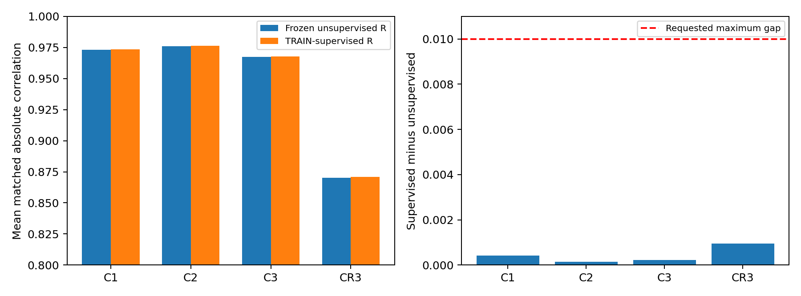
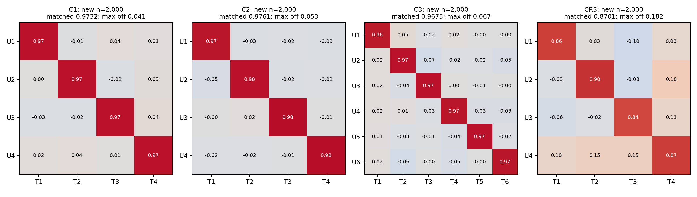
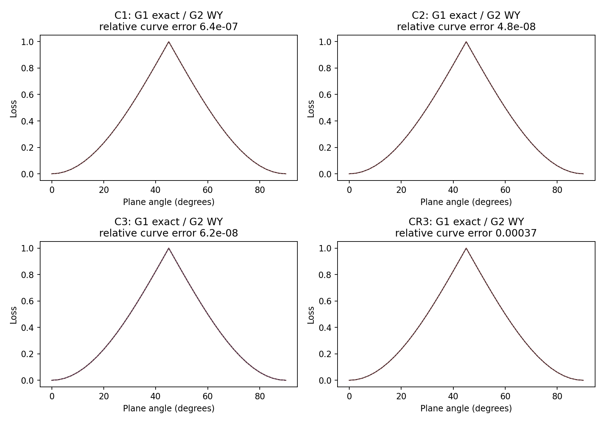

# 四模型三鸿沟实验：最终报告

2026-11-09。独立目录 `research/three_gap_series/`，共 339 个单候选结果。
按照用户选择的标准，**四模型均通过：与各自监督参考的平均匹配相关差≤0.01，错配接近参考**。
最终推荐 `transport_dual_cosine`，配合结构化数值 WY 估计器。
成立条件是显式刺激结构先验和 canonical logit；这不是纯 Hessian、无结构先验的通用成功。

## 冻结后新被试确认

每模型独立生成 2,000 名新被试，每人 500 次 Bernoulli 选择，经原冻结 encoder 提取新 Z。
R 在生成新数据前已冻结，hash 见 [manifest.json](manifest.json)，新被试没有用于拟合或选择 R。
参考也是原 TRAIN 上监督拟合的固定 R，之后在同批新被试上评价；**没有在新被试 T 上重拟合 oracle**。
C1–C3 原训练每人 300–500 trials；这里统一 500。CR3 保持原 500 行刺激库。

| 模型 | 无监督均值 | 监督参考均值 | 均值差 | 最差匹配 | 最大错配：方法 / 参考 |
|---|---:|---:|---:|---:|---:|
| C1 | 0.973165 | 0.973581 | 0.000416 | 0.971696 | 0.040623 / 0.037111 |
| C2 | 0.976133 | 0.976286 | 0.000153 | 0.967974 | 0.053275 / 0.047031 |
| C3 | 0.967455 | 0.967682 | 0.000227 | 0.960048 | 0.066990 / 0.061876 |
| CR3 | 0.870076 | 0.871020 | 0.000944 | 0.842828 | 0.181860 / 0.181045 |

错配为一一匹配后其余相关的绝对值；没有把“小错配”定义成一个事后调参的阈值。
CR3 的最大错配约 0.182，接近监督参考的 0.181，不能称为零泄漏。
监督参考是 TRAIN-only R+D 多起点数值解，不是已证明的全局最优上界。





## 指标与额外假设

设 g_s(x)=∇_Z η(Z_s,x)，对第 k 个刺激算子求响应变化 h_sk(x)。
M2 仅从数值 WY 估计平滑函数，M1 按预测 Fisher 权重 p(1-p) 解
`b_sk = argmin_b E_x[(g_s(x)^T b - h_sk(x))²]`，加入固定微小 ridge。
对每个 k 求 `E_s b_sk b_sk^T` 的主特征向量，得到前向方向矩阵 B 的列。
关键步骤是求 **A=B⁻¹ 的行方向（对偶恢复轴）**，不能把 B 的列直接当恢复轴。
原始 Z 不白化，其前向方向通常不正交；在此处混淆会增加错配。

M3 在纯正交 R 上最小化

`L(R) = d - max_permutation Σ_i cosine(row_i(R), row_pi(i)(A))²`。

匹配只对估计出的方向，**不使用真实 T**；结果评价时才与 T 做 Hungarian 匹配。
loss 对任意后置非零逐轴缩放、符号和排列不变。最终结果的数值审计误差约 1e-16，R 正交。
M1 使用 F0/F1 与 flow effects，**没有使用 Hessian；不可用“缺失=零”描述 F2**。

四模型使用同一个 M3、同一套方向求解规则，但 M2 函数类和刺激算子包含不同的显式先验：

- C1：全部原始 X 的≤2 次单项式，包括常数，共 10 个候选；按 TRAIN 投影残差选择 4 个。
- C2/C3：常数加 option-antisymmetric 的≤2 次属性项，共 6 个；C2 选择 4 个，C3 使用 6 个。
- C1–C3 M2：原始试次 WY→各被试刺激模板投影→完整 degree-3 latent polynomial (`profile`)。
  不提供真实生成系数、参数名称或参数标签。
- CR3：金额幂 flow `a→100(a/100)^exp(eps)`、loss-scale flow、概率 odds-power flow、输出 scaling。
  **使用已知金额参考 100 和这些功能变换的结构知识**，不是任意黑箱下自动发现对称性。
  flow 保留零金额，避开非法金额偏导，同时保留 gain-only / gamma-neutral 识别试次。
- CR3 M2：原 500 行数值 WY 上拟合独立的任意 gain/loss option-utility 曲面 (`utility`)。
  金额幂与概率 odds-slope 字典均为 0.2:0.2:1.4，每个曲面 49 通道，共 98 通道。
  未提供完整 CR3 参数式，未拟合共同 alpha/gamma、标量 lambda/tau；latent 同为完整 degree 3。
  仍然使用 option 差分、gain/loss 分面和平滑字典先验，不能称作无先验的函数推断。

标准化和完整多项式权重、隐藏正交旋转及 ridge 规则见代码；raw Z 和 PCA 均不白化。
所有 discovery 的均值/方差、样本选择、模板选择和函数拟合只用 TRAIN；VALIDATION 被试独立。
后置 D 只负责允许的尺度变换，不能把非正交 B⁻¹ 当成最终 R。

## 三个鸿沟的证据

**G1：** 真参数标准化坐标上的解析功能传输沿单参数轴。
理想 ridge=0、可识别设计下，每个前向 Gram 秩一，A 为轴方向，因此 L≥0 且真轴 L=0，
全局最优到符号/排列。实际实现有微小 ridge，另用每平面 37 点、64 个全空间起点核验。
四模型直接解析字段均通过预设严格数值检查；这不构成有限噪声下恢复的一般定理。

**G2：** 估计器只接收原始 WY 数字，不接收生成表达式或解析导数。
公式路径 M2 复现真轴；最差轴 cosine 均接近 1，CR3 约 0.99999997。
CR3 另有纯数值 flow 差分对照。解析路径用 Tstd，decoder 路径用中心化 raw Z；
**没有把 Tstd 的理想恒等旋转误当成 Z 的监督旋转**。

**G3：** 保持最终 M2/M1/M3，把 WY 来源换成冻结 decoder 的 logit，优化过程不读 T。
原 TEST 上的数字如下；该 TEST 已被多轮探索查看，因此只作为 development 结果。

| 模型 | 原 TEST 方法均值 | 原 TEST 监督均值 | 公式 WY 最差轴 cosine | decoder validation logit RMSE |
|---|---:|---:|---:|---:|
| C1 | 0.968695 | 0.969041 | 1.0000000000 | 0.012114 |
| C2 | 0.970982 | 0.971270 | 1.0000000000 | 0.046788 |
| C3 | 0.962732 | 0.962858 | 1.0000000000 | 0.085874 |
| CR3 | 0.870628 | 0.871973 | 0.9999999664 | 0.151552 |



C1–C3 direct 曲线来自 round34，WY 曲线来自 round35；CR3 direct 为 round37、WY 为 round33。
采样 seed 可不同，完整记录在 manifest 对应文件；不是逐点同样本误差统计。
CR3 的结构化曲面会平滑网络在固定设计间的插值：这是改变 estimand 的结构投影，
不是证明估计器精确复现了原网络的所有导数。其 decoder validation RMSE 约 0.152，
同时留出被试与刺激的 RMSE 约 0.146；公式约 0.002。不要用小预测误差推断 Hessian 正确。

**G4：** 上方独立新被试结果是冻结最终方案之后的确认。CR3 另一个 seed 的原 TEST 均值
0.870485（本方案 0.870628），支持数值稳定性；还不是重新训练 NP 的独立重复。

## 输出通道必须分别解释

| 条件 | 当前证据 | 可作出的结论 |
|---|---|---|
| logit η | 四模型 G1/G2/G3 与冻结后独立确认 | 推荐方案，在上述结构先验内通过用户标准 |
| deterministic p + canonical log-odds | round36 同一数值估计器单独复核 | 通过这条额外 link 条件；与 logit 均值差见 comparison.csv |
| native p Hessian | 早期逐通道扫描存在错误最优轴 | 不推荐，不宣称与 logit 等价 |
| Bernoulli→统计 log-odds | 早期 plain-signature 方案 C1–C3 独立新被试通过 | 属于另一组 M2/M3；不能扩张为最终统一指标四模型通过 |
| Bernoulli→最终 profile/utility transport | 当前实现明确拒绝该组合 | **四模型统一 binary 版本未验证，不宣称通过** |

新被试使用 Bernoulli 行为是 encoder 的新数据来源；这不等于 discovery 的 WY 通道也为 binary。
没有对单个 0/1 求导，也没有将原始真实 Y 冒充 decoder 模拟 Y。

## 为什么前面的候选失败

完整负结果保留在 inventory.csv 与各 round 的 summary/planes 中。
C1–C3 的 logit UU Hessian 恒零，无法区分轴；native-p 曲率包含 link 诱导交互。
CR3 单纯 UU off-diagonal、self curvature/variance、UX 支持度和多种组合，不能稳定通过全部鸿沟。
条件 absence/self-linearity 在解析与 WY 可成功，网络上的相同零结构却有系统偏差；
网络直接自动微分与数值差分方向一致，说明不只是差分步长的问题。
单位归一化每个弱效应列放大噪声；增加样本、换 degree、加入设计外中性锚点未自动解决。
把传输前向方向直接作为恢复轴亦会增加错配。已知完整 CR3 公式的反演控制虽接近监督，
但额外知识不同，未用于主结论。最终的有效变化是结构投影、保留有效识别试次和对偶几何。

## 复现

在仓库根目录的 cmd 中 `conda activate py11`。不修改原模型和其他实验目录。
每次单独运行一个模型、一个指标；C1/C2 beta=0.0005,zdim=4，C3 beta=0.0005,zdim=6，
CR3 beta=0.00005,zdim=4，均 pca=0。以 C1 为例：

```cmd
python research/three_gap_series/run.py --model C1 --beta 0.0005 --zdim 4 --pca 0 --source decoder --estimator profile --metric transport_dual_cosine --channel logit --degree 3 --ridge 0.000001 --utility-ridge 0.00001 --samples 1024 --starts 64 --mean-subjects 256 --mean-stimuli 256 --train-subjects 3500 --validation-subjects 750 --seed 20261115 --label round35_final_protocol
```

C2 改 model；C3 改 model 和 zdim。CR3 使用：

```cmd
python research/three_gap_series/run.py --model CR3 --beta 0.00005 --zdim 4 --pca 0 --source decoder --estimator utility --metric transport_dual_cosine --channel logit --degree 3 --ridge 0.000001 --utility-ridge 0.00001 --samples 1024 --starts 64 --mean-subjects 256 --mean-stimuli 256 --train-subjects 3500 --validation-subjects 750 --seed 20261115 --transport-access flow --label round33_utility_confirm
```

G2 换 `--source formula`；G1 换 `--estimator direct`；概率单列使用
`--channel probability --structure-link log_odds`。每次调用保存完整 flags、R、数据/代码 hash、
起点、曲线、采样索引与不变性审计。缓存只保留本机，summary 中同时保存 R。
新被试确认用 `fresh_cohort.py --model ... --beta ... --zdim ... --pca 0 --result <manifest中的decoder summary绝对路径> --subjects 2000 --seed <20261121/22/23/24>`。
重建本报告：`python research/three_gap_series/final_report.py`；
单测：`python -m unittest discover -s research/three_gap_series -p "test_*.py" -q`。

## 结论的边界

确认的是这四套固定 checkpoint、指定 beta/zdim、pca=0、模拟总体和上述结构先验。
未证明适用于其他 checkpoint、真实人类数据、其他生成模型、降维 PCA 或无先验黑箱函数。
尚无跨 NP 训练重复的置信区间；2,000 人确认不是穷尽总体。
raw Z 的表征本身有限，CR3 监督参考也约 0.87；不能据此承诺四轴均超过 0.90。
在用户明确选择的四模型接近各自监督参考标准内，本轮已找到可复现且独立确认的方案。
