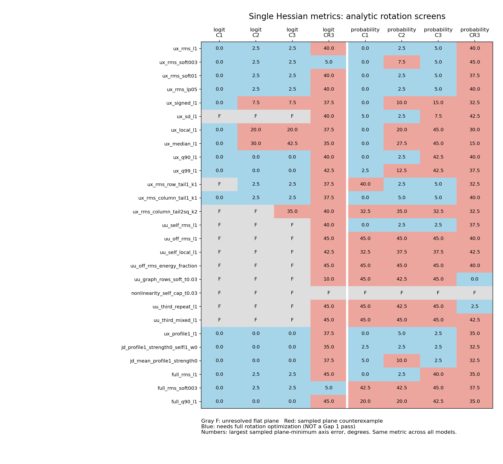

# 单一 Hessian 指标：两种输出尺度的首轮比较

本轮暂停组合与权重探索。共 9 个实现族、314 个去重后的单项定义；统计量和阈值变体均明确列出，不把它们当作 314 种独立思想。每个定义在四模型一致使用，并分别测 logit 与概率输出。

| 输出 | 模型 | 平面反例 | 平坦方向 | 待完整优化 |
|---|---|---:|---:|---:|
| logit | C1 | 2 | 216 | 96 |
| logit | C2 | 74 | 191 | 49 |
| logit | C3 | 110 | 156 | 48 |
| logit | CR3 | 303 | 4 | 7 |
| probability | C1 | 185 | 10 | 119 |
| probability | C2 | 245 | 8 | 61 |
| probability | C3 | 255 | 10 | 49 |
| probability | CR3 | 305 | 4 | 5 |

“待完整优化”不等于 Gap 1 成功。四模型均存活的同一单项才进入多起点完整旋转检查；Gap 1 真正通过后才检查 WY inference，再进入 decoder 验证。

## 完整优化与推断验证

| 轮次 | 模型 | 指标 | 全空间轴误差 | 结果 |
|---|---|---|---:|---|
| s02_single_joint_confirm | C1 | hs_full_rms_soft003 | 0.0000° | G1 PASS |
| s02_single_joint_confirm | C1 | hs_ux_rms_soft003 | 0.0000° | G1 PASS |
| s02_single_joint_confirm | C2 | hs_full_rms_soft003 | 2.8747° | G1 PASS |
| s02_single_joint_confirm | C2 | hs_ux_rms_soft003 | 2.8747° | G1 PASS |
| s02_single_joint_confirm | C3 | hs_full_rms_soft003 | 2.5608° | G1 PASS |
| s02_single_joint_confirm | C3 | hs_ux_rms_soft003 | 2.5615° | G1 PASS |
| s02_single_joint_confirm | CR3 | hs_full_rms_soft003 | 44.6507° | G1 FAIL |
| s02_single_joint_confirm | CR3 | hs_ux_rms_soft003 | 5.7526° | G1 PASS |
| s05_single_soft003_g2 | C1 | hs_ux_rms_soft003 | 0.0000° | G2 PASS |
| s05_single_soft003_g2 | C2 | hs_ux_rms_soft003 | 2.8747° | G2 PASS |
| s05_single_soft003_g2 | C3 | hs_ux_rms_soft003 | 2.5623° | G2 PASS |
| s05_single_soft003_g2 | CR3 | hs_ux_rms_soft003 | 5.3192° | G2 FAIL |
| s06_single_soft003_g2_degree2 | CR3 | hs_ux_rms_soft003 | 5.3220° | G2 FAIL |
| s07_single_soft003_g2_fullrbf | CR3 | hs_ux_rms_soft003 | 6.0683° | G2 FAIL |
| s08_single_soft003_g2_smoother | CR3 | hs_ux_rms_soft003 | 6.6206° | G2 FAIL |

G2 不仅看全空间轴误差，还检查各平面最低点、曲线相关和相对误差。因此表中轴误差低于 6° 仍可能 G2 失败。未列模型表示该推断分支尚未运行该模型，不能拼接不同分支冒充四模型通过。
当前尚未为这个单指标运行 G3；必须先有同一推断规则在四模型通过 G2。

需要分清的结论：

- C1/C2/C3 的 logit 对参数线性，纯 UU/UUU 单项的零场是解析不可辨识；更好的 inference 不能制造缺失的信息。
- 概率的 Hessian 会因 sigmoid 曲率引入额外耦合，所以“logit 不可辨识”不能直接推及概率，但额外曲率也不保证正确轴最简单。
- 符号平均、RMS、SD、局部绝对值、分位数要分开看；前者可能抵消，SD 会删除恒定交互，分位数改变对少数极端点的敏感性。
- 行尾部与列尾部描述不同的交互稀疏性；允许 top-k 项时，还可能出现代价为零的旋转自由度。
- 只压 UU 非对角可能把真正的交互转为自曲率；所以记录“偏好错轴”，不把较低 loss 当作成功。

[全部 logit 单项](../s01_single_metric_atlas/REPORT.md) · [全部概率单项](../s04_probability_single_atlas/REPORT.md)
